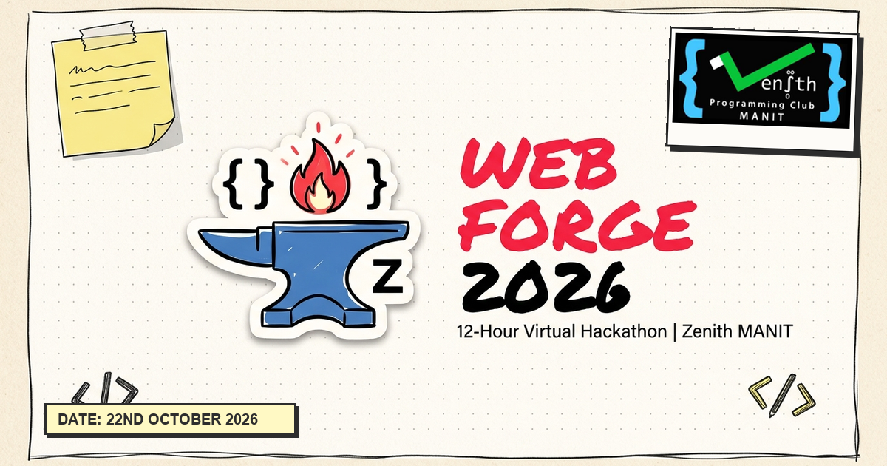

# Web Forge 2026 // Zenith MANIT

> An unfiltered 12-hour high-intensity virtual coding sprint organized by **Zenith**, the official programming club of **Maulana Azad National Institute of Technology (MANIT), Bhopal**.



---

## Event Details

- **Event Date:** 22nd October 2026
- **Duration:** 12 Hours (08:30 AM to 09:15 PM)
- **Format:** Virtual on Google Meet (Central Stage + Team Breakout Rooms)
- **Eligibility:** Undergraduate engineering students of MANIT Bhopal
- **Team Size:** Strictly 3 members per squad
- **Diversity Mandate:** At least 1 female developer per squad is strictly compulsory
- **Live Hacking Verification:** At least one team member must actively keep their screen shared in their Google Meet breakout room
- **AI Policy:** AI coding tools (Cursor, Claude, Copilot) are 100% encouraged! Velocity, architecture, and working products are what matter.

---

## Hand-Drawn Design System

Web Forge is built using an authentic **Hand-Drawn / Sketchbook / Post-It** design system:
- **No Straight Lines:** Irregular, wobbly border-radii (`border-wobbly-sm`, `border-wobbly-md`, `border-wobbly-lg`) on buttons, cards, and inputs.
- **Warm Paper Aesthetics:** `#fdfbf7` paper background with dot grid paper grain texture.
- **Pencil & Marker Palette:** Soft pencil lead (`#2d2d2d`), correction red marker (`#ff4d4d`), ballpoint blue pen (`#2d5da1`), and sticky note yellow (`#fff9c4`).
- **Cut-Paper Shadows:** Solid, hard offset box-shadows (`shadow-hand`, `shadow-hand-sm`) with zero blur.
- **Typography:** Handwritten Google Fonts (`Kalam` for felt-tip headings, `Patrick Hand` for pencil body text).

---

## Tech Stack

- **Framework:** [Next.js 16](https://nextjs.org) (App Router, Turbopack, Partial Prerendering)
- **Styling:** [Tailwind CSS v4](https://tailwindcss.com)
- **Database & Auth:** [Supabase](https://supabase.com) (PostgreSQL, Row Level Security)
- **Animations:** [Motion](https://motion.dev)
- **Icons:** [Lucide React](https://lucide.dev)
- **Email Service:** Brevo API

---

## Project Structure

```
├── public/
│   ├── favicon.ico
│   ├── icon-192.png
│   ├── icon-512.png
│   ├── og-image.png              # 1200x630 WhatsApp / Social Share card
│   ├── webforge-logo.png         # Hand-drawn Web Forge hackathon logo
│   ├── zenith-logo-clean.png     # Zenith Programming Club MANIT logo
├── src/
│   ├── app/
│   │   ├── actions/
│   │   │   └── registration.js   # Server actions (Team create/join, Supabase, Brevo emails)
│   │   ├── admin/
│   │   │   └── page.js           # Password-protected admin squad roster & CSV export
│   │   ├── register/
│   │   │   ├── create/page.js    # Dedicated Create Team form
│   │   │   ├── join/page.js      # Dedicated Join Team form
│   │   │   └── page.js           # Registration hub & Squad lookup
│   │   ├── team/[code]/page.js   # Dynamic team status and invite page
│   │   ├── layout.js             # Metadata, OpenGraph & Favicon configuration
│   │   └── page.js               # Landing page (Hero, Overview, Timeline, Rules, FAQ)
│   ├── components/
│   │   ├── FaqAccordion.jsx      # Hand-drawn interactive FAQ
│   │   ├── Footer.jsx            # Sketchbook footer with Zenith manifesto
│   │   ├── HandDrawnSvg.jsx      # Custom SVG tape strips, thumbtacks, and arrows
│   │   └── Header.jsx            # Responsive navigation & brand lockup
```

---

## Getting Started

### 1. Clone the repository
```bash
git clone https://github.com/Saumyakhushlani/Zenith-WebForge.git
cd Zenith-WebForge
```

### 2. Install dependencies
```bash
npm install
```

### 3. Environment Variables
Create a `.env.local` file in the root directory:
```env
NEXT_PUBLIC_SUPABASE_URL=your_supabase_project_url
NEXT_PUBLIC_SUPABASE_ANON_KEY=your_supabase_anon_key
SUPABASE_SERVICE_ROLE_KEY=your_supabase_service_role_key
BREVO_API_KEY=your_brevo_api_key
ADMIN_PASSWORD=your_secure_admin_password
NEXT_PUBLIC_SITE_URL=https://zenith-webforge.vercel.app
```

### 4. Run Development Server
```bash
npm run dev
```

Open [http://localhost:3000](http://localhost:3000) in your browser.

---

## Contact & Organization

- **Organized By:** Zenith — Programming Club of MANIT Bhopal
- **Official Contact Email:** `zenith.nitb.manit@gmail.com`
- **Location:** Maulana Azad National Institute of Technology (MANIT), Bhopal, MP 462003
